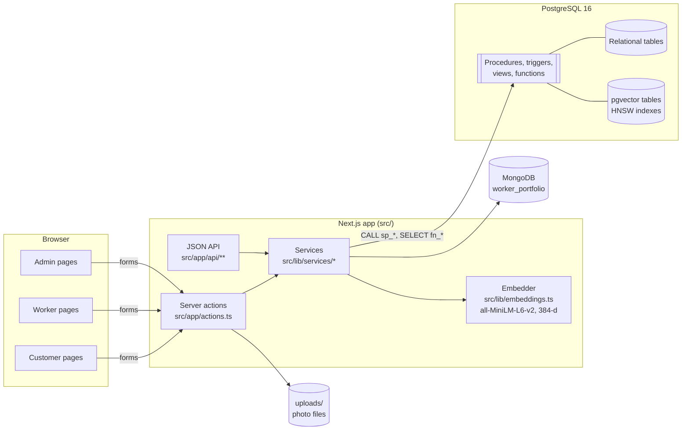

# Architecture

## The idea in one paragraph

A customer types a problem in plain language ("fan not spinning"). The app turns the text into a 384-number
**embedding**, finds the workers whose skills mean the same thing (**pgvector**, HNSW index), keeps only verified workers
who have a free slot, ranks them by similarity and reputation, and lets the customer book a slot. Booking reserves the slot,
books the request and issues the invoice in **one PostgreSQL transaction** inside a stored procedure, so two customers can
never get the same slot. Each worker's portfolio is different for every trade, so it lives in **MongoDB**.

## Components

## Why three data stores

| Store | What it holds | Why this paradigm | What would break without it |
|---|---|---|---|
| PostgreSQL (relational) | customers, workers, categories, slots, requests, bookings, invoices, payments, ratings, disputes | money and reservations need ACID transactions, foreign keys, constraints | double-booked slots, invoices without bookings, orphan payments |
| pgvector (inside the same PostgreSQL) | embeddings of worker skill/bio texts and of request texts | similarity of *meaning*, with an HNSW index so it stays fast | keyword search misses "fan not spinning" vs "ceiling fans that hum or turn slowly" (see the evaluation) |
| MongoDB (documents) | one portfolio per worker: trade, photos, certifications, trade-specific attributes | every trade has different fields (licence + voltage for electricians, subjects + grades for tutors, references for maids) | a relational table full of NULLs, or an entity-attribute-value mess |

pgvector lives **in the same PostgreSQL** as the relational data, so one SQL function (`fn_match_workers`) can do the
vector search *and* join verification status, availability and ratings in a single query.

## Main flows

**1. Customer posts a request** (`createRequest` in `src/lib/services/requests.ts`)
embed the text first -> one transaction inserts `service_request` + `request_embedding_vector`. If the model is down,
nothing is stored and the user sees an error (never a request without a vector).

**2. Matching** (`fn_match_workers`, migration 006)
ANN over worker vectors (HNSW, top 100 rows) -> best of skill/bio per worker -> filters (verified, similarity >= 0.25,
optional area/trade, has an open future slot) -> `final = 0.7 x similarity + 0.3 x bayesian_rating / 5`.
The app then loads worker details and the next 3 slots (2 queries) and portfolio previews (1 MongoDB query): no N+1.

**3. Booking** (`sp_create_booking`, migration 004)
`SELECT ... FOR UPDATE` on the slot -> checks (owner, open, future, verified worker, request open and owned) ->
insert booking -> slot `reserved` -> request `booked` -> invoice = hourly rate x hours. Any error rolls everything back.

**4. Cancellation** (`sp_cancel_booking`): refund 100 % (>= 24 h before, or worker/admin cancels), 50 % (2-24 h), 0 % (< 2 h);
slot re-opened (customer) or blocked (worker); request re-opened; invoice voided or refunded.

**5. Job outcome and rating**: worker marks `completed` or `no_show` (only after the slot started). No-show -> trigger opens
a dispute. Customer rates a completed job -> trigger recomputes the worker's average -> leaderboard and matching use it at once.

**6. Worker registration / profile edit** (`src/lib/services/workers.ts`)
There is no transaction across PostgreSQL and MongoDB, so the order is fixed: **PostgreSQL first** (source of truth),
then MongoDB, then embeddings. Steps 2-3 are retried once; if they still fail the worker is kept and
`npm run db:reconcile` repairs the drift (missing portfolio, orphan portfolio, stale or missing embeddings).

## Defence against double booking (layers)

| Layer | Mechanism | Catches |
|---|---|---|
| 1 | row lock `SELECT ... FOR UPDATE` on the slot in `sp_create_booking` | concurrent bookings: the 2nd waits, then sees `reserved` -> `SLOT_TAKEN` |
| 2 | partial unique index `ux_booking_active_slot` (`WHERE status <> 'cancelled'`) | any code path that skips layer 1 |
| 3 | composite FK `booking(slot_id, worker_id) -> availability_slot(slot_id, worker_id)` | booking worker A into worker B's slot |
| 4 | exclusion constraint `ex_slot_no_overlap` (GiST, `tstzrange &&`) | a worker with overlapping slots |
| 5 | triggers: booking status machine, slot guard | illegal transitions, editing a booked slot |

Isolation level: default READ COMMITTED is enough because correctness comes from the row lock plus the unique index.
Lock order is always booking -> slot -> request -> invoice -> payment, so procedures cannot deadlock each other.
Proof: `npm run test:concurrency` (20 simultaneous attempts per round, exactly one wins).

## Roles

| Role | Can | Enforced by |
|---|---|---|
| Customer | post requests, see matches, book, pay, cancel, rate, report a problem | `requireRole('customer')` on every page/action + ownership checks inside the procedures (`SM011`) |
| Worker | register, edit profile and portfolio, manage availability, complete / no-show / cancel own jobs, see matching open requests | `requireRole('worker')` + `WHERE worker_id = <session>` in every query |
| Admin | verify workers, resolve disputes (with refunds), analytics | `requireRole('admin')` |

Sign-in is a demo identity picker with a signed (HMAC-SHA256), HTTP-only cookie. There are no passwords because the ER
model has no credential columns (see `03-er-changes.md`).

## Source map

| Path | What |
|---|---|
| `db/postgres/migrations/001..006` | schema, vector tables, functions + triggers, procedures, views, matching |
| `db/postgres/seed/` + `db/seed/workers.json` | demo data (40 workers, 6 customers, ~190 past jobs, live bookings) |
| `db/postgres/tests/` | 47 SQL tests (`npm run test:db`) |
| `src/lib/services/` | one file per area; every state change calls one stored procedure |
| `src/lib/embeddings.ts` | the embedder and what text is embedded |
| `src/app/actions.ts` | all form handlers (server actions) |
| `src/app/**/page.tsx` | pages for the three roles |
| `src/app/api/**` | JSON API (`/api/requests`, `/api/requests/:id/matches`, `/api/bookings`, ...) |
| `scripts/` | reset, embed, reconcile, tests, evaluation, benchmarks |
| `docs/evidence/` | results of the evaluation, benchmarks and tests |
