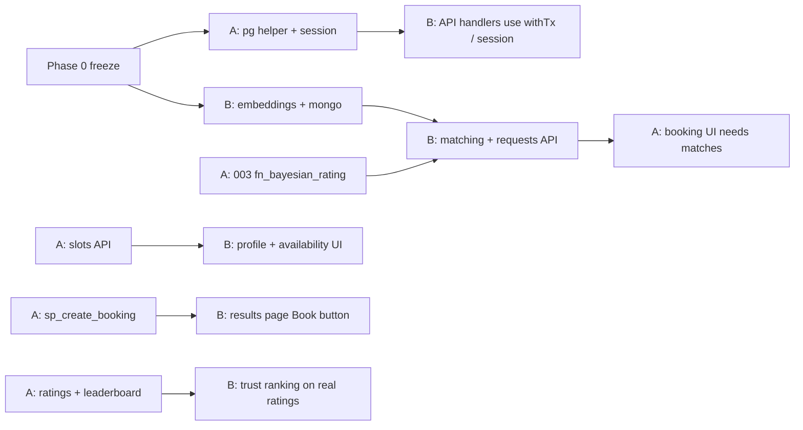

# 01 - Execution plan

**Assumptions** (change them if wrong): two people, ~5 weeks, ~80 focused hours each for the core backlog plus a few stretch hours. No deadline was given - if yours is shorter, cut in this order: stretch items, reverse matching UI, analytics charts, Hinglish, DB roles. Never cut: the booking procedure + concurrency test, the rating trigger, the semantic-vs-keyword evaluation, the HNSW evidence.

## 1. Split at a glance

| | **Person A - Transactional core** | **Person B - Semantic matching & flexible data** |
|---|---|---|
| Data stores | PostgreSQL relational logic | pgvector + MongoDB |
| Advanced features owned | Transactions, triggers, stored procedures, views, relational indexing | Vector similarity search, HNSW indexing, NoSQL document design |
| Backend | slots, bookings, cancel/refund, payments, ratings, disputes, admin, analytics, session/guards, DB error mapping | embeddings, requests, matching/ranking, worker profiles, portfolio + uploads, reverse matching |
| Screens | customer: book/confirm, my bookings, pay, rate, dispute - worker: jobs - admin: verification, disputes, analytics, leaderboard | customer: post request, ranked results, worker profile with portfolio - worker: onboarding/profile, portfolio, availability editor |
| Proof artefacts | concurrency test, rollback test, trigger tests, index EXPLAIN evidence | evaluation table (semantic vs keyword), HNSW benchmark, schema-flexibility demo |
| Core hours | ~81 | ~77 |

Detailed task lists with hours: `PERSON_A_CONTEXT.md` section 7 and `PERSON_B_CONTEXT.md` section 8.

## 2. Phases

### Phase 0 - Kickoff (Day 0-1, together, about 3 hours)
- [ ] Read `04-decisions-and-er-changes.md`; confirm D1-D9 (and talk to your guide about the ER changes and D1/D2).
- [ ] `git init`, commit this kit, create `main` + feature-branch workflow.
- [ ] Both: `cp .env.example .env`, `docker compose up -d --wait`, `./scripts/db-reset.sh`; run the sanity queries in README.
- [ ] Freeze: migrations 001/002, `contracts/types.ts`, `03-api-contract.md`. From now on changes go through `CHANGELOG.md`.
- [ ] Agree cadence (section 4).
- **Exit:** both have the same working local databases; open questions resolved or recorded.

### Phase 1 - Foundations (Week 1)
| Person A | Person B |
|---|---|
| Scaffold `web/`; `lib/db/pg.ts` (pool, `withTx`), `lib/errors.ts`, `lib/session.ts`, dev login, layout/nav | `lib/embeddings` (model loads, `embed()` + tests), `lib/db/mongo.ts`, Mongo validator + seed |
| Migration 003: `fn_bayesian_rating`, rating trigger(s), booking status-guard trigger | `scripts/embed-all.ts` (embeds seeded workers), `GET /api/categories` |
| Slots API (list/create/block/delete, overlap error) | Matching SQL v1 on seeded data (`100_matching.sql`) |
| | Worker profile read endpoint |
- **Milestone M1 (end of Week 1):** `SELECT * FROM fn_match_workers(<seeded request>)` returns sensible rows; slots API works; both merged to `main`; contract unchanged or CHANGELOG'd.

### Phase 2 - Core logic end-to-end (Week 2)
| Person A | Person B |
|---|---|
| `sp_create_booking`, `sp_pay_invoice`, `sp_cancel_booking` (+ SQL tests) | `POST /api/requests` (embed + store), `GET /api/requests/:id/matches` with Mongo preview merge |
| Booking/invoice/payment APIs | Customer UI: post request + ranked results cards |
| Customer UI: slot confirm, my bookings, pay | Worker profile page with portfolio; worker registration API |
- **Milestone M2:** happy path in the browser: type "AC not cooling" -> ranked workers -> pick slot -> booking + invoice -> pay.

### Phase 3 - Full lifecycle and all roles (Week 3)
| Person A | Person B |
|---|---|
| complete / no-show endpoints + no-show trigger; rating + dispute APIs | Worker portal UI: onboarding/profile editor, trade-specific portfolio forms, photo upload, availability editor |
| Worker jobs page; rating UI; dispute UI | Reverse matching (`matched-requests`) |
| Admin: verification queue, dispute resolution (`sp_resolve_dispute`) | Synthetic dataset generator (60-100 workers, 40 labelled queries) |
- **Milestone M3:** every role can complete its whole journey; no placeholder screens.

### Phase 4 - Prove the database features (Week 4)
| Person A | Person B |
|---|---|
| Views: leaderboard + admin KPIs, leaderboard/analytics pages | Evaluation script: semantic vs keyword (P@5, MRR, hard subset); tune alpha/threshold |
| `scripts/test-concurrency.ts`, rollback test, trigger tests | HNSW benchmark (latency + recall vs exact) at 10k-100k vectors |
| Slot-lookup index benchmark at 100k+ slots (EXPLAIN ANALYZE) | Mongo flexibility demo set; polish search UX (loading, empty, low-confidence states) |
| **Joint:** cross-training session (each explains their half to the other for 45 min), final seed data, bug bash |
- **Milestone M4 (feature freeze):** all acceptance tests in `05-test-and-demo-plan.md` pass.

### Phase 5 - Polish, report, rehearse (Week 5)
- Final ER diagram with the 10 changes; report sections and screenshots from the evidence list below.
- Clean-clone test: fresh machine/clone -> `docker compose up` -> `db-reset.sh` -> app runs.
- Two full demo rehearsals with timing; each person demos their own half.
- Bug fixes only; no new features.

## 3. Dependencies (what blocks what)

Mitigation for every arrow: the consumer codes against the example responses in `03-api-contract.md` and seeded data until the producer merges, so nobody sits idle.

## 4. Working agreements
- **Daily 10-minute sync** (or async post): done yesterday / doing today / blocked on the other person.
- **Branches:** `a/<task>` and `b/<task>`; PR into `main`; the other person reviews (<= 30 min). `main` must always pass `./scripts/db-reset.sh` and `npm run build`.
- **Integration day every Friday:** merge, reset DBs from scratch, click through the whole flow together.
- **Definition of done for a task:** works from a clean `db-reset.sh`; has a test or a documented manual check; contract respected; PR reviewed; evidence captured if the task is on the evidence list.
- **Evidence habit:** save every EXPLAIN output, benchmark table and test log to `docs/evidence/` as you go - the report writes itself from it.

## 5. Risks and mitigations

| Risk | Likelihood | Mitigation |
|---|---|---|
| Embedding model download/slow start inside Next.js | Medium | Singleton + warm-up on server start; cache dir `.hf-cache/`; `embed()` interface lets you swap to a tiny Python/FastAPI sidecar or a hosted API without touching callers. |
| HNSW + filters returns fewer than N workers | Medium | Over-fetch (`MATCH_ANN_CANDIDATES`), threshold tuning, iterative scans if available; document as a known trade-off. |
| Contract drift between A and B | Medium | Frozen contract + CHANGELOG + Friday integration day. |
| Double-booking test is flaky or passes by luck | Low-Med | Test with 20+ concurrent clients and repeat 20 times; also run once with the row lock removed to *show* the unique index catches it. |
| Mongo/pgvector out of sync with PostgreSQL | Medium | PG first; reconcile script; run it in the demo. |
| Scope creep (auth, payments, geo) | High | D2/D3/D7 decisions; out-of-scope list in 04. |
| Embedding dimension change | Low | One constant in `.env`, one in migration 002; re-embed with `embed-all.ts`. |
| Time-zone bugs in slots | Medium | `timestamptz`, UTC over the wire, format only in the UI. |
| One person falls behind | Medium | Backlogs are P0/P1/P2 ordered; cross-training in Week 4 means either can demo anything. |

## 6. Advanced-feature checklist from the synopsis (where each is satisfied)

| Synopsis feature | Where | Owner | Proof |
|---|---|---|---|
| Transactions: atomic slot reservation + booking + invoice | `sp_create_booking` | A | rollback test + concurrency test |
| Triggers: update worker rating on review | `trg_rating_aiud` | A | trigger test |
| Triggers: flag no-shows | `trg_booking_noshow` | A | trigger test |
| Stored procedures: booking creation | `sp_create_booking` | A | procedure source + tests |
| Stored procedures: cancellation with refund | `sp_cancel_booking` | A | 3 refund-tier tests |
| Vector similarity search | `fn_match_workers`, HNSW | B | evaluation table |
| Views: leaderboard per category | `v_worker_leaderboard` | A | query + page |
| Indexing: availability lookups | partial indexes | A | EXPLAIN before/after |
| Indexing: HNSW on embeddings | `ix_*_embedding_hnsw` | B | latency/recall benchmark |
| NoSQL for variable portfolios | MongoDB `worker_portfolio` | B | 4 trades, 4 shapes demo |

## 7. Evidence to collect for the report (`docs/evidence/`)
1. Semantic-vs-keyword table (P@5, MRR, hard subset).
2. HNSW vs exact scan: latency and recall at 10k/50k/100k.
3. `EXPLAIN ANALYZE` of slot lookup, with and without the partial index.
4. Concurrency test output (N clients, exactly 1 success).
5. Rollback test output (forced failure leaves no partial rows).
6. Refund-tier test output.
7. Trigger demos (rating -> average changes; no-show -> dispute appears).
8. Screenshots of each role's journey; final ER diagram.
