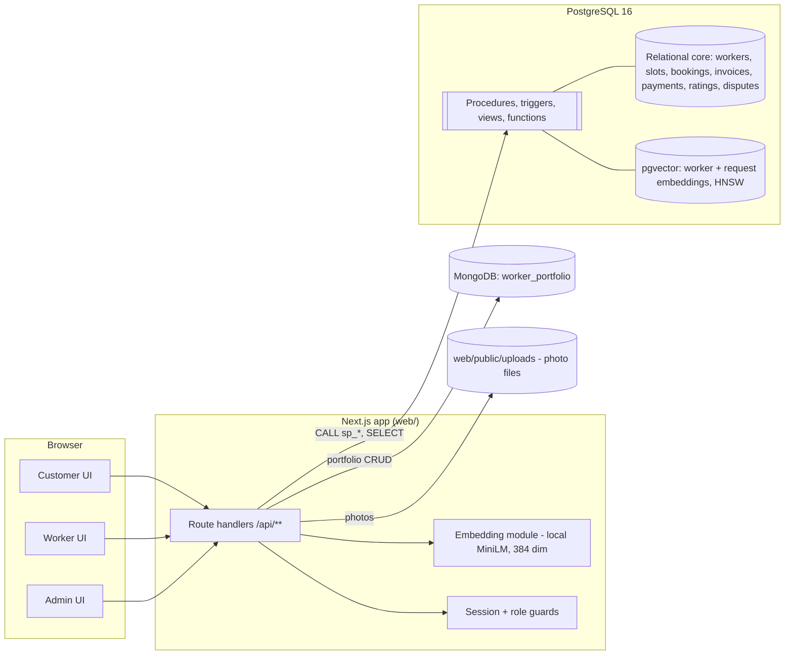

# 02 - Architecture

## 1. System overview



Why three stores (this is the core of the viva - know these answers):

| Store | Holds | Why this paradigm, and what breaks without it |
|---|---|---|
| PostgreSQL (relational) | customers, workers, categories, slots, requests, bookings, invoices, payments, ratings, disputes | Money and reservations need ACID transactions and referential integrity. Without it: double-booked slots, invoices without bookings, orphaned payments. |
| pgvector (inside PostgreSQL) | embeddings of request text and of worker skill/bio text | Keyword/SQL search misses "fan not spinning" -> an electrician whose profile says "ceiling fans, regulators". Cosine similarity over embeddings finds meaning, with an HNSW index so it stays fast. It lives in the same PostgreSQL, so a match can be joined with availability and ratings in one query. |
| MongoDB (document) | worker portfolios: photos, certifications, trade-specific attributes | An electrician has a licence number and voltage rating, a tutor has subjects and grade levels, a maid has references. One relational table would be mostly NULLs, or an EAV mess. A document per worker holds each shape naturally. |

## 2. Technology choices

| Concern | Choice | Notes |
|---|---|---|
| App | Next.js (App Router) + TypeScript, `web/` | Route handlers are the API. Server components may call the same lib functions. |
| PostgreSQL driver | `pg` (node-postgres), raw SQL | No ORM on the booking path: the procedures must be visible and demonstrable. |
| Vector | pgvector, `vector(384)`, cosine (`<=>`), HNSW (`m=16, ef_construction=64`) | npm `pgvector` helper for serialising arrays. |
| Embeddings | `@huggingface/transformers` (formerly `@xenova/transformers`) with `Xenova/all-MiniLM-L6-v2`, quantised, mean-pooled, normalised | First call downloads the model (~25-90 MB depending on variant); cache it (`.hf-cache/`). Singleton loaded once per server process. |
| MongoDB | official `mongodb` driver, one collection `worker_portfolio` | JSON-schema validator on shared fields only. |
| UI | Tailwind (from create-next-app) | Keep it simple; the marks are in the data layer. |
| Local infra | `docker compose` (pgvector/pgvector:pg16, mongo:7) | `./scripts/db-reset.sh` rebuilds everything. |

## 3. Data flows

### 3.1 Worker onboarding / profile edit (Person B)
1. PG transaction: upsert `worker` (+ `worker_category` rows). New workers start `pending`. Commit.
2. Mongo: upsert `worker_portfolio` by `worker_id` (trade, photos, certifications, `trade_attributes`).
3. Embeddings: build `skill` text and `bio` text, embed, upsert two rows in `worker_embedding_vector`.
4. Steps 2-3 can fail after step 1 commits (no cross-DB transaction). Retry once, then log; `scripts/reconcile.ts` finds workers missing a portfolio or embeddings and repairs them. PostgreSQL decides whether a worker exists.

### 3.2 Request -> ranked matches (Person B)
1. `POST /api/requests`: embed the description; in one PG transaction insert `service_request` + `request_embedding_vector`.
2. `GET /api/requests/:id/matches`: call the matching SQL function (section 5), then fetch portfolio previews from Mongo with one `$in` query on the returned `worker_id`s and merge in app code.

### 3.3 Booking (Person A) - the transactional heart
`POST /api/bookings` -> `CALL sp_create_booking(customer, request, worker, slot, NULL)`, all inside one transaction:
lock slot row -> validate -> insert booking -> mark slot reserved -> mark request booked -> insert invoice. Any failure rolls the whole thing back. Details and error codes: `PERSON_A_CONTEXT.md` section 6.1.

### 3.4 Cancel with refund (Person A)
`POST /api/bookings/:id/cancel` -> `sp_cancel_booking`: compute refund tier from time-to-start and who cancels, cancel booking, free (or block) the slot, reopen the request, void/refund the invoice and payment. One transaction.

### 3.5 Rating -> leaderboard (Person A)
Customer rates a completed booking -> trigger recomputes `worker.avg_rating` / `rating_count` -> `v_worker_leaderboard` and matching trust scores see the new value immediately.

## 4. Roles and what each can do

| Role | Capabilities | Enforced where |
|---|---|---|
| Customer | post request, see matches, book, pay, cancel, rate, raise dispute | API guards + ownership checks inside procedures (e.g. `sp_create_booking` verifies the request belongs to the customer) |
| Worker | register/edit profile + portfolio, manage availability, see own jobs, mark complete/no-show/cancel, see matching open requests | API guards; slot/booking ownership checked in SQL `WHERE worker_id = $session` |
| Admin | verify/reject workers, resolve disputes, view analytics/leaderboards | API guards (`role = 'admin'`) |

Stretch (Person A): real PostgreSQL roles (`app_customer`, `app_worker`, `app_admin`) with GRANTs, to show least privilege at DB level.

## 5. Matching design (Person B)

```
request text --embed--> q (384-d, normalised)
stage 1  ANN: top K=100 rows of worker_embedding_vector by  embedding <=> q     (HNSW)
stage 2  best similarity per worker (a worker has a 'skill' row and a 'bio' row)
stage 3  filters: verified, similarity >= threshold, optional locality/category,
         has >= 1 open future slot (LATERAL: earliest slot)
stage 4  trust = (n*avg + 5*3.5) / (n + 5)          -- Bayesian smoothing, n = rating_count
         final = alpha*similarity + (1-alpha)*trust/5     (alpha = 0.7)
```
Why smoothing: a worker with one 5-star rating must not outrank one with 80 ratings averaging 4.7.
Reference query (tested on PostgreSQL 16 + pgvector): `db/postgres/reference/matching_skeleton.sql`.
Known limitation to discuss in the report: filters after ANN can return fewer than `limit` rows; mitigations are a larger K or pgvector's iterative index scans (version >= 0.8).

## 6. Integrity design - layers of defence against double booking (Person A)

| Layer | Mechanism | Catches |
|---|---|---|
| 1 | `SELECT ... FOR UPDATE` on the slot row inside `sp_create_booking` | two concurrent bookings: the second waits, then sees `reserved` and fails cleanly with `SLOT_TAKEN` |
| 2 | Partial unique index `ux_booking_active_slot` | any code path that forgets layer 1 |
| 3 | Composite FK `(slot_id, worker_id)` | booking a slot that belongs to another worker |
| 4 | Exclusion constraint on slots | overlapping availability for one worker |
| 5 | Triggers (status guard, rating guard) | illegal state transitions |

Lock order is always **slot, then request** to avoid deadlocks. Default isolation `READ COMMITTED` is sufficient because correctness comes from the row lock + unique index; mention `SERIALIZABLE` + retry as the alternative.

Cross-database consistency (Mongo/pgvector vs PostgreSQL): no foreign keys across stores; the dotted lines in the ER diagram are *logical* references. Rules: PostgreSQL first, derived stores second, repair script for drift.

## 7. Index plan (and the evidence each one needs for the report)

| Index | Serves | Evidence to capture |
|---|---|---|
| `ix_slot_worker_open_start` (partial, `status='open'`) | "next open slots of worker X" in matching and in the slot picker | `EXPLAIN ANALYZE` before/after on 100k+ slots |
| `ix_slot_start_open` (partial) | global "open future slots" scans | same |
| GiST exclusion index on slots | overlap prevention | demo of rejected overlapping insert |
| `ux_booking_active_slot`, `ux_booking_active_request` (partial unique) | double-booking backstop | concurrency test output |
| `ix_worker_embedding_hnsw` / `ix_request_embedding_hnsw` | ANN search | latency + recall vs exact scan at 10k-100k vectors |
| `ix_booking_worker_status`, `ix_request_customer`, `ix_worker_category_cat`, `ix_worker_status_locality`, `ix_payment_invoice`, `ix_dispute_status` | list screens, joins | mention only |

## 8. Repository layout and ownership

```
skillmarket/
|- docker-compose.yml  .env.example  CLAUDE.md  README.md
|- contracts/types.ts                    shared, frozen (changes via CHANGELOG)
|- db/
|  |- postgres/
|  |  |- migrations/  001 (A, shared baseline) 002 (B)  003-099 (A)  100-199 (B)
|  |  |- seed/        001_reference_data.sql  002_history.sql   (shared; ask before changing)
|  |  |- reference/   matching_skeleton.sql                       (B)
|  |  `- tests/       A_*.sql / A_*.ts   B_*.sql
|  `- mongo/          init.js  seed.js                           (B)
|- scripts/
|  |- db-reset.sh                                                 (shared)
|  |- test-concurrency.ts  bench-slots.ts                         (A)
|  `- embed-all.ts  reconcile.ts  gen-dataset.ts  eval-matching.ts  bench-hnsw.ts   (B)
|- web/                                      create-next-app output
|  `- src/
|     |- app/api/...                         by endpoint owner, see 03-api-contract.md
|     |- app/(customer)/...  (B: requests/new, requests/[id], workers/[id])  (A: bookings, pay, rate)
|     |- app/worker/...      (B: profile, portfolio, availability)           (A: jobs)
|     |- app/admin/...                                                       (A)
|     |- lib/db/pg.ts  lib/session.ts  lib/errors.ts                         (A)
|     |- lib/db/mongo.ts  lib/embeddings/  lib/matching/                     (B)
|     |- lib/contracts.ts                                                    (copy of contracts/types.ts)
|     `- lib/nav.ts                                                          (A owns; B appends links only)
`- docs/
```

Conflict-avoidance rules: each person only edits their own files; `lib/nav.ts` and `docs/CHANGELOG.md` are append-only for both; migrations never share a number range; one PR per task, reviewed by the other person (30-minute review budget).

## 9. Configuration
See `.env.example`. `EMBEDDING_DIM` must equal the `vector(N)` in migration 002. Matching knobs (`MATCH_ALPHA`, `MATCH_MIN_SIMILARITY`, `MATCH_ANN_CANDIDATES`) are read by Person B's code only.

## 10. Time zones
Store `timestamptz` (UTC). The seed creates slots in IST. API returns ISO-8601 UTC strings; the UI formats with `Asia/Kolkata`.
