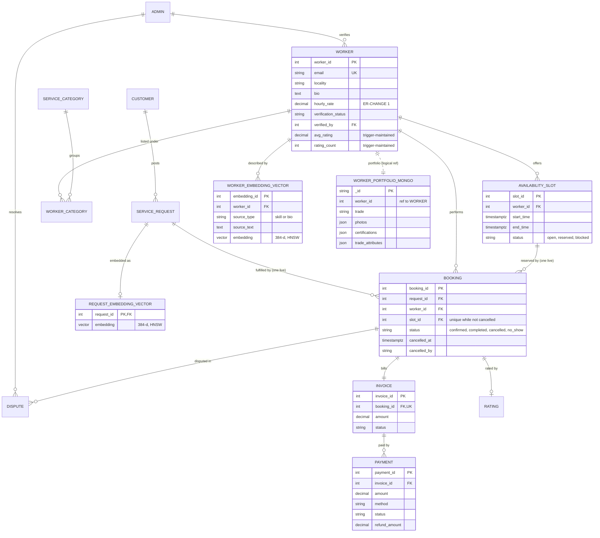

# Database reference

## ER model (as implemented)


(ADMIN, CUSTOMER, SERVICE_CATEGORY, WORKER_CATEGORY, SERVICE_REQUEST, RATING and DISPUTE have the same columns as the submitted ER diagram.)

## Migrations

| File | Contents |
|---|---|
| `001_core_schema.sql` | 12 relational tables, CHECK constraints, composite FK, exclusion constraint, partial unique indexes, lookup indexes |
| `002_vector.sql` | `worker_embedding_vector`, `request_embedding_vector`, HNSW indexes (`vector_cosine_ops`, m = 16, ef_construction = 64) |
| `003_functions_triggers.sql` | `fn_bayesian_rating`, triggers T1-T5 |
| `004_procedures.sql` | 8 stored procedures |
| `005_views.sql` | leaderboard and analytics views |
| `006_matching.sql` | `fn_match_workers`, `fn_match_requests_for_worker` |

## Stored procedures (migration 004)

| Procedure | Does, atomically |
|---|---|
| `sp_create_booking(customer, request, worker, slot, INOUT booking_id, INOUT invoice_id)` | lock slot, validate, insert booking, reserve slot, book request, issue invoice |
| `sp_cancel_booking(booking, actor_role, actor_id, INOUT refund, INOUT policy)` | refund tier (100/50/0 %), cancel, re-open/block slot, re-open request, void or refund invoice + payment |
| `sp_pay_invoice(invoice, customer, method, INOUT payment_id)` | ownership + status check, payment row, invoice paid |
| `sp_set_booking_outcome(booking, worker, 'completed'/'no_show')` | only after the slot started; closes the request |
| `sp_rate_booking(booking, customer, score, comment, INOUT rating_id)` | ownership + one rating per booking |
| `sp_raise_dispute(booking, role, actor, reason, INOUT dispute_id)` | only a party to the booking |
| `sp_resolve_dispute(dispute, admin, status, note, refund)` | refund capped at what was paid minus already refunded |
| `sp_review_worker(worker, admin, 'verified'/'rejected')` | sets status and reviewer |

## Triggers (migration 003)

| Trigger | When | Rule |
|---|---|---|
| T1 `trg_rating_biu` | before insert/update on `rating` | booking must be `completed` (`SM009`) |
| T2 `trg_rating_aiud` | after insert/update/delete on `rating` | recompute `worker.avg_rating` and `rating_count` (locks the worker row first) |
| T3 `trg_booking_status_guard` | before update of `booking.status` | only `confirmed -> completed / cancelled / no_show` (`SM008`) |
| T4 `trg_booking_noshow` | after update to `no_show` | opens one `system` dispute |
| T5 `trg_slot_guard` | before update/delete on `availability_slot` | a reserved slot cannot be deleted, changed or re-opened by hand (`SM013`); the booking procedures switch it off for their own statements |

## Views (migration 005)

`v_worker_leaderboard` (RANK() per category on the Bayesian score), `v_net_payment`, `v_platform_kpis`,
`v_category_stats`, `v_revenue_by_day`.

## Indexes

| Index | Serves |
|---|---|
| `ix_slot_worker_open_start` (worker_id, start_time) WHERE status = 'open' | "next open slots of worker X" (matching, profile, booking) |
| `ix_slot_start_open` WHERE status = 'open' | global open-slot scans |
| GiST index of `ex_slot_no_overlap` | overlap prevention |
| `ux_booking_active_slot`, `ux_booking_active_request` (partial unique) | double-booking backstop |
| `ix_worker_embedding_hnsw`, `ix_request_embedding_hnsw` (HNSW, cosine) | semantic search both ways |
| others (`ix_booking_worker_status`, `ix_request_customer`, ...) | list pages and joins |

Measured effect: `docs/evidence/bench-results.md` (`npm run bench`).

## Error codes

Procedures and triggers raise custom SQLSTATEs; `src/lib/errors.ts` maps them to messages and HTTP statuses.

| SQLSTATE | Code | | SQLSTATE | Code |
|---|---|---|---|---|
| SM001 | SLOT_TAKEN | | SM009 | RATING_NOT_ALLOWED |
| SM002 | SLOT_IN_PAST | | SM010 | DISPUTE_NOT_OPEN |
| SM003 | REQUEST_NOT_OPEN | | SM011 | FORBIDDEN |
| SM004 | WORKER_NOT_VERIFIED | | SM012 | NOT_FOUND |
| SM005 | SLOT_WORKER_MISMATCH | | SM013 | SLOT_NOT_EDITABLE |
| SM006 | BOOKING_NOT_CANCELLABLE | | SM014 | TOO_EARLY |
| SM007 | INVOICE_NOT_PAYABLE | | SM015 | INVALID_REFUND |
| SM008 | INVALID_STATUS_TRANSITION | | 23P01 | SLOT_OVERLAP |

## MongoDB

Database `skillmarket`, collection `worker_portfolio`, one document per worker, unique index on `worker_id`, index on `trade`.
A `$jsonSchema` validator enforces only the shared fields (`worker_id` int, `trade`, `photos[]`, `certifications[]`,
`trade_attributes` object with optional `skills: string[]`, `updated_at`). Everything else in `trade_attributes` is free.

## Useful queries for the viva

```sql
-- what the matcher sees for a request
SELECT * FROM fn_match_workers(<request_id>);
-- prove the HNSW index is used
SET enable_seqscan = off;
EXPLAIN SELECT worker_id FROM worker_embedding_vector ORDER BY embedding <=> (SELECT embedding FROM request_embedding_vector LIMIT 1) LIMIT 10;
-- leaderboard
SELECT * FROM v_worker_leaderboard WHERE rank_in_category <= 3 ORDER BY category_name, rank_in_category;
-- KPIs
SELECT * FROM v_platform_kpis;
```
Open a SQL shell with: `docker compose exec postgres psql -U skillmarket skillmarket`
